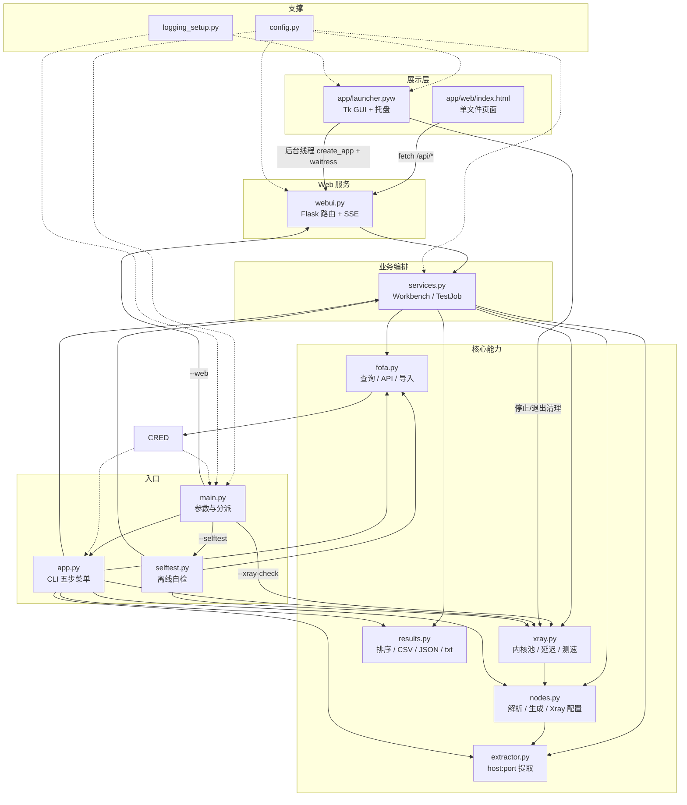

# 代码结构说明

> 本文档基于对 `D:\v2ray_test` 源码的只读扫描整理，未修改任何 `.py` 逻辑。文中行数为 `Get-Content` 逐文件统计的实际值（含空行，不含 `__pycache__`、`app/tmp` 下的临时脚本与运行产物）。

## 1. 一句话总览

这是一个**本地运行的 Cloudflare 优选 IP → VLESS 节点批量生成 + 真实测速工具**：从 FOFA 搜索或本地文件拿到 `host:port`，套进一条或多条 `vless://` 示例模板生成节点，再调用本机 `xray.exe` 内核做真实延迟与下载测速，最后导出 v2rayN 可导入的 txt、以及 CSV/JSON 结果。

四层结构：

| 层 | 组成 | 说明 |
| --- | --- | --- |
| 前端页面 | `app/web/index.html`（1926 行，单文件，CSS/JS 全内联） | 6 个页面步骤：FOFA 搜索 → 导入资产 → 提取预览 → 生成节点 → 测试 → 结果与导出；通过 JSON API + SSE 访问后端 |
| Web 服务 | `app/vless_tool/webui.py`（Flask 路由） | 提供页面、REST API、SSE 测试进度流；实际由 waitress 承载（8 线程），Flask 内置服务器仅作未安装 waitress 时的回退 |
| 核心业务 | `services.py`、`xray.py`、`nodes.py`、`extractor.py`、`fofa.py`、`results.py` | CLI 与 Web 共用的业务编排、内核进程池与并发测试、节点生成、资产提取、FOFA 查询、结果导出 |
| 启动器 / 入口 | `launcher.pyw`（Tk GUI + Win32 托盘）、`main.py`（CLI 入口） | 启动器负责起停 Web 服务、托盘与状态机；`main.py` 提供菜单、`--web`、`--selftest` 等命令行入口 |

数据流（后端一次会话的状态链）：

```text
FOFA API / 本地文件 / 粘贴文本
        │
        ▼
  import（落到 app/tmp/work）
        │
        ▼
  extract（extractor.py 正则提取 + 去重 + 端口/私有地址过滤）
        │
        ▼
  generate（nodes.py：只替换 host:port，保留示例的 UUID 与 query 参数）
        │
        ▼
  test（xray.py：每 kernel_batch 个节点共用一个内核进程，先延迟后测速）
        │
        ▼
  export（results.py：vless txt / CSV / JSON，输出到 downloads/）
```

## 2. 模块清单表

| 文件 | 行数 | 主要职责 | 关键函数/类（3~6 个） | 依赖哪些同项目模块 | 被谁调用 |
| --- | ---: | --- | --- | --- | --- |
| `app/main.py` | 164 | 命令行入口：解析参数、补齐 `config.json`、初始化日志、分派 CLI/Web/自检/内核检查 | `build_parser`、`main`、`_ensure_config`、`_config_example_candidates`、`_prepare_console` | `vless_tool.app`、`config`、`logging_setup`、`selftest`、`xray`；`webui`/`probe_kernel` 为惰性导入 | 用户命令行；不是打包 exe 的入口 |
| `app/launcher.pyw` | 1259 | 单文件 exe 入口：Tk 窗口、Win32 托盘图标、服务启停状态机、单实例、两种无人工自检 | `Launcher`、`TrayIcon`、`build_tray_menu`、`run_tray_selftest`、`run_ui_selftest`、`check_single_instance` | `vless_tool.config`、`logging_setup`、`xray`；线程内惰性导入 `webui`、`waitress` | 用户双击 exe；`python app\launcher.pyw` |
| `app/make_icon.py` | 152 | 纯标准库生成 `app.ico`（圆角渐变底 + 折线图形），仅在仓库缺少 `app.ico` 时由打包脚本兜底调用 | `build_ico`、`_render`、`_dib`、`_lerp`、`_inside_rounded` | 无 | `app/build_exe.ps1` |
| `app/vless_tool/__init__.py` | 3 | 包版本号 | `__version__` | 无 | `app.py` 等 |
| `app/vless_tool/app.py` | 776 | 中文 CLI 菜单与五步业务流（菜单 1 只生成语句/打开浏览器，不含采集与凭据） | `Application`、`AppState`、`_extract_flow`、`_generate_flow`、`_test_flow`、`_results_flow`、`_export_top`、`_show_statement` | `__init__`、`config`、`extractor`、`fofa`、`nodes`、`results`、`services`、`xray`、`logging_setup` | `main.py` 默认分支 |
| `app/vless_tool/config.py` | 204 | 内置默认配置、`config.json` 深合并、路径解析、原子写回、区域名映射、程序根目录判定 | `Config`、`DEFAULT_CONFIG`、`find_config_path`、`_program_root`、`_deep_merge` | 仅标准库 | `main`、`launcher`、`app`、`webui`、`services`、`selftest`、`xray`（鸭子类型读取） |
| `app/vless_tool/extractor.py` | 554 | 从 txt/csv/json/html 中提取 `host:port`，校验主机/端口、去重、过滤私有地址与黑名单端口，保存中间 txt/json | `Endpoint`、`ExtractStats`、`extract_file`、`extract_from_text`、`extract_files`、`save_endpoints` | 仅标准库 | `services`、`webui`、`app`、`selftest`（`fofa` 的导入流也复用其保存格式思路） |
| `app/vless_tool/fofa.py` | 338 | 拼装「地区/国家 · 线路 · 端口」FOFA 查询语句与 qbase64 搜索链接、粘贴/本地文件导入 | `build_search_query`、`fofa_options`、`fofa_search_url`、`qbase64_encode`、`import_text`、`import_local_file`、`build_query` | 仅标准库（`base64`/`json`/`re`/`shutil`/`pathlib`） | `app`、`webui`、`selftest` |
| `app/vless_tool/logging_setup.py` | 45 | 统一 `vless_tool` logger：控制台 + 5MB×5 轮转 UTF-8 `run.log` | `setup_logging`、`get_logger` | 仅标准库 | `main`、`launcher`、`app` |
| `app/vless_tool/nodes.py` | 518 | 校验/解析 `vless://` 示例，按端点生成节点（只换地址端口、改名），构建 Xray streamSettings 与单节点/进程池配置 | `VlessTemplate`、`VlessNode`、`parse_vless_link`、`generate_nodes`、`build_xray_stream_settings`、`build_xray_pool_config` | `extractor.Endpoint` | `services`、`xray`、`app`、`selftest` |
| `app/vless_tool/results.py` | 267 | 结果排序、终端表格、CSV/JSON 保存、vless 链接与端点 TXT 导出 | `save_results`、`export_links`、`export_hosts_txt`、`export_node_links`、`format_table`、`sorted_results`、`sorted_for_export` | `nodes`、`xray.NodeResult`、`extractor.country_display` | `services`、`app`、`selftest` |
| `app/vless_tool/selftest.py` | 458 | 离线全链路自检：固定样例提取→生成→模拟测试→四种导出→FOFA 语句/多示例/导出规则/提取三组样本→Xray 配置字段 | `run_selftest`、`_run_fofa_search_checks`、`_run_extract_input_checks`、`_run_multi_sample_checks`、`_run_export_checks` | `config`、`extractor`、`fofa`、`nodes`、`results`、`services`、`xray` | `main.py --selftest` |
| `app/vless_tool/services.py` | 807 | CLI 与 Web 共用业务编排：导入、合并提取、生成、后台测试任务、SSE 事件、导出、文件列表 | `Workbench`、`TestJob`、`extract_and_save`、`extract_many`、`generate_nodes_from_text`、`export_links_file` | `config`、`extractor`、`fofa`、`nodes`、`results`、`xray` | `webui`、`app` |
| `app/vless_tool/webui.py` | 582 | Flask 应用与全部 HTTP/SSE 路由、页面文件读取与来源优先级、waitress 启动、端口占用提示 | `create_app`、`run_server`、`_resolve_index_html`、`_external_index_path`、`_environment_info` | `config`、`services`、`extractor`、`fofa`、`nodes` | `main --web`；`launcher` 的服务线程；`--ui-selftest` 间接调用 |
| `app/vless_tool/xray.py` | 1279 | Xray 内核路径解析/探测、进程注册与清理、端口分配、共享内核进程池、延迟/测速、并发控制、错误分类、计时刻录、模拟测试器 | `XrayTester`、`NodeResult`、`PortAllocator`、`ProcessRegistry`、`WindowsKillJob`、`probe_kernel`、`cleanup_all_processes`、`simulate_results` | `nodes`；`config` 以鸭子类型使用 | `services`、`app`、`main`、`launcher`、`selftest` |

## 3. 分层说明

### 3.1 `main.py`：入口与参数

- 参数：`--config`、`--selftest`、`--xray-check`、`--web`、`--host`（默认 `127.0.0.1`）、`--port`（默认 `8765`）、`--no-browser`。
- `find_config_path()` 决定配置文件位置，`_ensure_config()` 在缺失时依次尝试：同目录 `config.example.json` → `main.py` 所在目录 → `sys._MEIPASS`，复制为 `config.json`。
- `Config.load()` 读取并深合并内置默认值；`ensure_dirs()` 创建下载/工作/导出/临时/日志目录；`setup_logging()` 初始化日志。
- 分派优先级：`--selftest` → `--web` → `--xray-check` → 默认 CLI 菜单（不会触发任何凭据检查）。
- `finally` 中统一 `cleanup_all_processes()`，`KeyboardInterrupt` 返回 130，异常返回 1，配置失败返回 2。

### 3.2 `launcher.pyw`：GUI + 托盘 + 状态机

- 窗口 480×420、不可缩放；控件为「状态」（服务地址/引擎/Xray 内核/配置路径）、「端口」输入、「启动/停止」合并按钮、「退出」、「打开工作目录」、日志 `Text`、底栏提示。
- 单实例：`check_single_instance()`；已有实例时尝试激活窗口，失败则提示“已在运行（见系统托盘）”。
- 托盘用 `ctypes` + `Shell_NotifyIconW`（`NIM_ADD` / `NIM_DELETE`），消息 `WM_TRAYICON = WM_APP + 1`；右键菜单为 tkinter 原生 `Menu`，顺序固定：`显示窗口`、`打开页面`、`打开工作目录`、分隔线、`退出`。
- 启动流程：端口校验 → 端口占用则弹窗不启动 → 按钮变「启动中…」并禁用 → 后台线程用 `waitress.create_server(... threads=8)` 起服务 → 每 150/300ms 探测端口，最长 15 秒 → 端口监听成功才进入「运行态」→ 托盘就绪时自动打开浏览器并 `withdraw()` 收进托盘。
- 停止流程：后台线程 `httpd.close()` → 最长 3 秒等端口释放 → `cleanup_all_processes()` → 置 `Event`；主线程轮询后恢复按钮为「启动」。tkinter 控件只在主线程更新。
- 退出流程 `_do_exit()`：停服务并等端口释放 → 清理 Xray 子进程 → `NIM_DELETE` → `quit()`/`destroy()`。窗口「退出」按钮与托盘「退出」共用该方法。
- X（`WM_DELETE_WINDOW`）与最小化统一走 `_hide_to_tray()`；只有托盘就绪才允许隐藏，否则窗口保持显示。
- `--noconsole` 下未捕获异常写入 `app/logs/launcher_error.log`；导入失败写 `launcher_import_error.log`，顶层崩溃写 `launcher_crash.log`。

### 3.3 `webui.py`：HTTP/SSE 路由与页面读取

- `create_app()` 创建 Flask（`static_folder=None`），挂载 `Workbench` 到 `app.extensions["bench"]`；上传上限为 `MAX_UPLOAD_BYTES + 1MB`。
- 页面路由 `GET /` 每次请求重新解析页面路径并读取全文，返回 `Cache-Control: no-store`，因此改外部页面后刷新即生效。
- 页面来源优先级（`_resolve_index_html`）：
  1. 打包运行且存在 `<exe目录>\app\web\index.html` → 外部页面；
  2. 否则 `_MEIPASS\web\index.html`（包内副本，外部缺失时告警）；
  3. 源码运行 → `app/web/index.html`。
- 路由：`/api/state`、`/api/files`、`/api/fofa/options`、`/api/fofa/query`、`/api/import/upload|paste|local`、`/api/extract`、`/api/endpoints`、`/api/samples/validate`、`/api/generate`、`/api/nodes`、`/api/test/start|stop|stream`、`/api/results`、`/api/export`、`/api/download/<name>`、`/api/xray`。
- `GET /api/test/stream` 为 SSE：事件带递增 `seq`、支持 `Last-Event-ID` 续传、心跳约 10 秒、服务端 `retry` 2000ms。
- `run_server()` 先检查端口占用（占用则打印提示并返回 1），再尝试 waitress（`threads=8`、`channel_timeout=180`），未安装时回退 Flask 内置服务器；1 秒后按需打开浏览器。

### 3.4 `services.py`：业务编排（CLI 与 Web 共用）

- `Workbench` 保存一次会话状态：`endpoints`、`nodes`、`results`、`files`、`stats`、`region`、`job`、`exports`，所有读写加 `RLock`。
- 导入：`add_files` 追加上传/本地路径；`import_local_path` 限制扩展名后交给 `fofa.import_local_file`。
- 提取：`extract_many` 逐文件提取并跨文件去重，单文件失败只记 warning；`extract_and_save` 把中间 txt/json 写到 `work_dir`。
- 生成：`generate_nodes_from_text` 合并旧单示例字段与 `samples`，最多 10 条示例，校验分配模式 `random|sequential`，再调用 `nodes.generate_nodes`。
- 测试：`start_test` 创建后台 `TestJob`（带 `Condition`、只追加事件、保留最近 1 万条），通过 `options` 覆盖 `test.*` 运行时配置；禁止并发第二个任务。
- 事件：`progress`（仅 `latency` 模式的延迟完成）/`update`（`latency_speed` 模式下每个节点的唯一回调）/`done`/`error`/`log`；两种事件都带 `index/done/total`，且 `update()` 找不到同序号结果时会 `append`（修复延迟+测速模式结果表为空）。任务结束 `finally` 中 `cleanup_all_processes()` 并按延迟排序落 `self.results`。
- 落盘：`done` 前自动调用 `export_results_files()` 写 CSV+JSON，成功才把 `exports`（含绝对路径与行数）随 `done` 事件与 `/api/state` 回传；写盘失败记 `export_error`；0 个成功节点不写空文件，`export_error="未产生可导出结果：N 个节点全部失败"`。
- 导出：`export_links_file` 支持 `all`（全部节点）、`speed`、`latency`；`all` 沿用页面当前排序，`latency`/`speed` 固定按延迟升序/速度降序（失败垫底）；`/api/export` 还提供 `share`（仅返回链接文本）、`api`（`IP:端口#国旗-国家`）、`selected`（勾选行的 vless 链接 TXT，不过滤失败）；文件名统一 `中文用途_YYYYMMDD_HHMMSS.ext`，同秒冲突追加 `_2`、`_3`；`export_results_files` 输出 `测试结果_*.csv/.json`。
- 限制：上传单文件 32MB、示例 10 条。

### 3.5 `xray.py`：内核进程池、延迟/测速、并发控制与清理

- 路径：`resolve_xray_executable()` 支持目录/文件/相对路径；失效时在 `base_dir/xray` 与 `base_dir` 递归找 `xray.exe`，找到后回写 `config.json`。`probe_kernel()` 用最小 socks 入站做一次真实启动验证，并检查端口监听、进程清理与残留。
- 进程管理：`ProcessRegistry` 注册/终止子进程；Windows 下用 Job Object（`WindowsKillJob`）确保子孙进程随任务结束；全局 `cleanup_all_processes()` 供退出/停止/异常统一调用。
- 端口：`PortAllocator` 在 `test.port_start`~`test.port_end` 内探测空闲端口，批量分配/释放。
- 池化模型（实际实现）：`test_nodes()` 每 `kernel_batch` 个节点切一批；每批生成**一个** Xray 进程与**一个**配置文件（`build_xray_pool_config`），每个节点一个独立本地入站端口（socks 或 http，由 `test.test_inbound` 决定），出站按节点一一对应。
- 启动等待：`_wait_ports()` 等整批端口可连接，进程提前退出或超过 `startup_timeout` 则整批标记 `kernel_exited` / `kernel_start_failed`，并附带日志尾部。
- 延迟：`_latency_task()` 每节点独立 `requests.Session`（`trust_env=False`），按 `latency_samples` 采样，`latency_sample_mode=best` 取最小值、`average` 取均值；`retries` 控制额外重试次数；500 及以上视为失败。
- 测速：`_speed_task()` 只对延迟成功的节点执行，流式下载并按 `speed_max_bytes` / `speed_max_seconds` 提前截断，换算 Mbps；并发受 `speed_concurrency` 限制。
- 并发：延迟阶段 `ThreadPoolExecutor(max_workers=min(latency_concurrency, 节点数))`；测速阶段同理用 `speed_concurrency`，避免测速抢带宽。
- 清理：每批 `finally` 终止内核、关闭 stdout 句柄、释放端口、删除临时目录（`keep_temp_on_error` 可保留）。
- 计时刻录：`_record_timing()` 写 `timing.jsonl`，`last_timing_summary` 汇总各批次 setup/teardown 耗时。
- 错误分类：`_classify_error()` 输出 `connection_timeout`、`network_broken`、`tls_failed`、`connection_failed`、`protocol_error`、`proxy_connection_failed`、`proxy_error`、`kernel_exited`、`kernel_start_failed`、`unknown_failed` 等。
- 离线模拟：`SimulatedTester` / `simulate_results()` 为自检与 Web 演示生成确定性的延迟/速度/失败结果，不启动真实内核。

### 3.6 `nodes.py`

- `parse_vless_link()`：必须以 `vless://` 开头；UUID 必填（`strict_uuid` 时校验标准 8-4-4-4-12）；`encryption` 必须为 `none`；`type` 支持 `tcp/ws/grpc/http/h2/kcp/quic/xhttp`；`security` 支持 `none/tls/reality`；`reality` 必须带 `pbk` 且带 `sni` 或 `host`；一次汇总所有错误。
- `generate_nodes()`：按 `limit` 截断，跳过重复 `host:port`；多示例按 `random`（洗牌分桶，保证每条模板被用到）或 `sequential`（1,2,3…循环）分配；只替换 URL authority 中的地址与端口，再改 fragment 名称，UUID 与全部 query 参数（含 `path`、`sni`、`host`、`flow`、`fp`、`alpn` 等）原样保留。
- 名称模板支持 `{region}`、`{index}`、`{latency}`、`{address}`、`{port}`；占位延迟默认 `待测`；导出时再替换为 `xxxms` 或 `xxxms-x.xMbps`。
- `build_xray_stream_settings()` 把分享参数映射为 Xray `streamSettings`（ws/grpc/h2/xhttp/tcp/reality/tls 等），`build_vless_outbound()` 生成出站。
- `build_xray_config()` 为**单节点**调试/自检配置（socks + http 两个本地入站）；真实批量测试用 `build_xray_pool_config()`（每节点 1 个入站，共用一个内核）。

### 3.7 `extractor.py`

- 支持 `.txt/.csv/.json/.html/.htm`；文本按 UTF-8（含 BOM）/常见编码兜底读取；HTML 去标签，JSON 递归展平，CSV 逐行拼文本。
- 五种正则：`_IPV4_PORT_RE`（`1.2.3.4:443`）、`_HOSTNAME_PORT_RE`（`cdn.example.com:8443`）、`_IPV6_PORT_RE`（`[2606:4700::1111]:443`）、`_BARE_IP_RE` / `_BARE_IPV6_RE`（无端口纯 IP，IPv6 必须含 `::`）、`_VLESS_URL_RE`（`vless://UUID@host[:port]?...`）；主机名校验（长度、标签、顶级域字母、非纯数字标签）。
- 处理顺序：先抹掉 vless 链接再按明文匹配，避免链接里的地址被重复计入；随后 vless → 纯 IPv4 → 纯 IPv6。纯 IP 需上下文干净（排除 `12:34:56`、`/api/v1/7.8.9.10/status`、`v1.2.3.4` 等），缺端口补 `extract.default_port`（默认 443）。
- 过滤：端口 1~65535、`port_allowlist`（非空时白名单生效）、`port_blocklist`、`exclude_private_ip`（`ipaddress.is_global` + localhost/.local/.lan 等）、`max_items` 截断。
- 去重键为 `host.lower():port`，同批与跨文件均生效；`Endpoint.kind` 记录 `明文` / `纯IP补端口` / `vless链接`。
- 统计 `ExtractStats`：候选、重复、非法、私有/本地、端口过滤、截断、`ip_without_port`（补默认端口条数）、`vless_links`；`save_endpoints()` 输出 `extracted_<时间戳>[_label].txt` 与带元数据（含 `kind`）的 JSON 到指定目录。

### 3.8 `fofa.py`

- 查询语句固定骨架：`server=="cloudflare"` → 地区/国家 → 端口 → `header="Forbidden"` → 线路 ASN 包含 → 固定排除 19 个 ASN。
- 地区字段：港澳台用 `region`，其余国家用 `country`；端口支持标准端口组、单端口、非标端口（排除 443/2096/8443/2053/2083/2087）。
- 线路 ASN：移动、联通、电信、一线机房、二线机房、海外 VPS、全部（不拼 ASN）。
- `build_search_query()` 返回 `query`、FOFA 网页搜索 `url`、`qbase64`、语义化描述与 clauses，供页面展示/复制。
- 只做语句生成与结果导入：`build_query()` / `build_search_query()` 完全本地拼装；`fofa_search_url()` / `qbase64_encode()` 生成搜索链接，不发任何 API 请求，也不读取凭据。
- 导入：`import_text()` / `import_local_file()` 把内容/文件复制到工作目录并生成同源 `.meta.json`。

### 3.9 `results.py`

- `format_table()` 生成终端对齐表格；`sorted_results()` 按延迟或速度排序。
- `save_results()`：`results_<时间戳>.csv` + `.json`；CSV 字段覆盖地址、端口、地区、名称、延迟、速度（Mbps 与 MB/s）、下载量、状态、错误类型/中文原因、尝试次数、详情、测试时间、vless 链接；JSON 另含延迟样本明细与原始字节数。
- `export_links()` / `export_node_links()`：导出 txt（每行一条链接，时间戳命名）；`export_hosts_txt()` 输出 `IP:端口#国旗-国家`（缺国家只留 `IP:端口`）；`sorted_for_export()` 供所有导出按页面排序（字段+方向，失败垫底）。
- 导出链接的名称会写入实测 `延迟` 或 `延迟-速度`。

### 3.10 `config.py`

- `DEFAULT_CONFIG` 是运行时真正的默认值来源（`Config.load` 用 `_deep_merge` 合并），覆盖 `xray_path`、各目录、`regions`、`fofa`、`extract`、`generate`、`test`、`output`。
- `find_config_path()` 顺序：`--config` → 环境变量 `VLESS_CONFIG` → 程序根 `config.json` → `app/config.json` → 当前工作目录；都找不到时返回程序根路径，交给上层自动生成。
- `Config.get("a.b.c")` 点号读取；`resolve()` 把相对路径接到 `base_dir`；`ensure_dirs()` 建立五类目录；`save()` 先写 `.tmp` 再 `os.replace` 原子替换。
- `_program_root()`：源码运行返回 `app/` 的父目录；PyInstaller 冻结运行返回 `sys.executable` 所在目录。
- `region_name()` 用 `regions` 列表把国家代码映射为中文名。

### 3.11 `app.py`（CLI 菜单）

- 主菜单 5 项：1 生成 FOFA 语句、2 选文件提取、3 生成节点、4 Xray 测试、5 结果导出/重测、0 退出（不再有凭据向导）。
- 第 1 步支持内置地区清单、自定义国家代码、粘贴文本、导入本地文件；生成语句后可直接打开 FOFA 搜索页，结果落到工作目录。
- 第 2 步从 `download_dir` 列出候选文件（也支持手输路径），提取后把端点、统计与来源文件写入 `AppState`。
- 第 3 步校验示例链接（可多示例）、设置地区/数量/名称模板后生成节点。
- 第 4 步调用 `XrayTester.test_nodes()`，逐条打印延迟/速度/状态，结束后排序并保存 CSV/JSON。
- 第 5 步导出全部/按速度/按延迟链接，支持重测选中项与查看失败原因。
- 所有导出写到 `export_dir`（默认 `downloads/`）。

### 3.12 `selftest.py`

- 使用 `app/sample_data/fofa_sample.json` 固定样例，在 `app/tmp/selftest/` 下复制文件并重定向 `temp_dir`。
- 校验：6 条有效端点、私有地址/非法端口过滤、中间文件写入、示例 `ws/tls` 参数保留、6 节点生成、缺参报错、模拟结果分类、CSV/JSON、四种 txt 导出、FOFA 语句、多示例分配、TopN、Xray 配置字段（socks+http 双入站、WS/TLS/SNI/ALPN）、子进程清理。
- 结论写入 `selftest_summary.json` 并打印 PASS/FAIL 与产物目录；不访问网络、不启动真实内核。

### 3.13 `logging_setup.py`

- `setup_logging()` 为 `vless_tool` logger 挂一个 `RotatingFileHandler`（`run.log`，单文件 5MB、保留 5 份、UTF-8、DEBUG 级）和一个控制台 handler（INFO 级）；已存在 handler 时直接复用，避免重复输出。
- `launcher.pyw` 额外挂 `QueueLogHandler` 把日志送进 GUI 日志框，并将 waitress/werkzeug/flask 的 logger 一并接入。

## 4. 调用关系图



## 5. 常见改动指引表

| 想改什么 | 改哪个文件 | 是否需要重新打包 | 怎么验证 |
| --- | --- | --- | --- |
| 页面文案/样式 | 源码改 `app/web/index.html`；打包后可直接改 `<exe目录>\app\web\index.html` | 源码运行不需要；打包后外部页面可覆盖，无需重打包；改包内副本需重打包 | 刷新浏览器（响应 `no-store`）；运行后看日志“页面来源：外部/包内” |
| 按钮布局/页面步骤 | `app/web/index.html`（`.flow-step`、各 `<section>`、内联 CSS） | 同上 | 浏览器检查 6 个步骤锚点与各面板交互；窄屏查看布局 |
| 启动器启停与托盘菜单 | `app/launcher.pyw`（`_build_ui`、`start_server`/`stop_server`、`TRAY_MENU_LABELS`、`build_tray_menu`、`_do_exit`） | 需要重打包（exe 入口就是它） | `python app\launcher.pyw --ui-selftest`、`--tray-selftest`；手动点启动/停止、X、托盘退出 |
| 测试模式（仅延迟 / 延迟+速度） | 页面开关 → `services.start_test` / `_runtime_config` → `xray.XrayTester` 的 `speed_enabled`；合法值 `latency`、`latency_speed` | 改后端代码/内置页面需重打包；仅改外部页面不需 | `POST /api/test/start` 传 `test_mode`；看 `job.mode` 与结果中是否有 `speed_mbps` |
| 并发与超时参数 | `config.json` 的 `test.*`（`latency_concurrency`、`speed_concurrency`、`kernel_batch`、`latency_timeout`、`startup_timeout`、`speed_max_bytes` 等）；默认值在 `app/vless_tool/config.py` | 改 `config.json` 不需要；改默认值需重打包 | 测试后看 `app/logs/run.log` 的 `[timing]` 与 `timing.jsonl`；观察批次/耗时 |
| FOFA 语句规则 | `app/vless_tool/fofa.py`（`FOFA_SEARCH_BASE_CLAUSE`、`FOFA_EXCLUDED_ASNS`、`FOFA_LINE_OPTIONS`、`FOFA_PLACE_OPTIONS`、`build_search_query`） | 需要重打包（模块在包内） | 页面第 1 步切换三个下拉，核对“查询语句”；或调用 `GET /api/fofa/query` |
| 节点生成规则 | `app/vless_tool/nodes.py`（`parse_vless_link`、`generate_nodes`、`_template_plan`、名称模板）；默认数量/模板在 `config.json` 的 `generate.*` | 改代码需重打包；改配置不需要 | `python app\main.py --selftest`；或页面第 4 步生成后核对链接只换了 host:port |
| 提取规则 | `app/vless_tool/extractor.py`（五种正则、`_parse_vless_token`、`_bare_ip_context_ok`、`_valid_host`、`_is_private_or_local`、过滤逻辑）；默认端口与端口黑白名单在 `config.json` 的 `extract.*` | 改代码需重打包；改配置不需要 | 用三种样本（纯 IP / vless / 混合）跑第 2 步，核对“候选/去重/私有/补默认端口/vless 链接”；`--selftest` 断言 A~E 五组 |
| 导出字段 | `app/vless_tool/results.py`（`save_results` 的 `fields`、JSON payload、`export_links` 命名与排序） | 需要重打包 | 跑一次测试后检查 `downloads/results_*.csv/json` 与 `vless_*.txt` 行数、字段 |
| 配置默认值 | `app/vless_tool/config.py` 的 `DEFAULT_CONFIG`；如需新装默认文件同步 `app/config.example.json` | 改默认值需重打包；仅模板文件不影响已存在的 `config.json` | 删除/改名 `config.json` 后启动，检查自动生成内容；`--selftest` |
| Xray 内核路径 | `config.json` 的 `xray_path`，或把 `xray.exe` 放到 `app/xray/xray.exe` | 不需要 | `python app\main.py --xray-check`；页面“Xray 内核”状态 |
| Web 路由/接口 | `app/vless_tool/webui.py` | 需要重打包 | `python app\main.py --web --no-browser`，用浏览器或 `curl` 访问对应接口 |

## 6. 配置与路径

### 6.1 `config.json` 与 `app/config.example.json`

- 仓库根 `config.json` 是实际运行配置（当前存在，顶层键为 `_readme`、`xray_path`、`download_dir`、`work_dir`、`export_dir`、`temp_dir`、`log_dir`、`regions`、`fofa`、`extract`、`generate`、`test`、`output`）。
- `app/config.example.json`（91 行）是模板：仅在 `config.json` 缺失时由 `main._ensure_config()` 复制生成；打包时也被塞进包内供首次运行生成。
- 运行时真正补齐缺字段的是 `config.py` 的 `DEFAULT_CONFIG`（深合并），不是示例文件本身；因此**只改 `config.example.json` 不会改变已有 `config.json` 的行为**。
- 相对路径统一以 `_program_root()` 为基准解析，与 `config.json` 实际所在目录无关。

### 6.2 `_program_root()` 的两种结果

| 运行方式 | 返回 | 本项目实际值 |
| --- | --- | --- |
| 源码运行（`python app\main.py` / `python app\launcher.pyw`） | `vless_tool/config.py` 上溯三级：`vless_tool` → `app` → 项目根 | `D:\v2ray_test` |
| PyInstaller 冻结运行（onefile exe） | `Path(sys.executable).parent` | `D:\v2ray_test`（exe 拷贝到此处） |

`Config.base_dir` 固定等于 `_program_root()`，所以 `./downloads`、`./app/xray/xray.exe` 等相对路径在两种模式下都指向 exe/仓库根下的同名位置。

### 6.3 各目录用途

| 目录 | 配置键 | 用途 |
| --- | --- | --- |
| `downloads/` | `download_dir`，同时是默认 `export_dir` | 第 2 步手工选择的历史文件列表来源；导出的 `results_*.csv/json`、`vless_*.txt` 落在这里 |
| `app/tmp/work/` | `work_dir` | 上传文件/粘贴文本/本地导入的副本、FOFA 原始分页与规范化结果、端点中间文件、每个测试批次的 `config.json`/`error.log`/`process.log`；测试结束默认删除批次目录 |
| `app/tmp/` | `temp_dir` | 工作目录的父目录；真实批量测试实际在 `work_dir` 下建批次目录，`temp_dir` 主要被自检重定向使用 |
| `app/logs/` | `log_dir` | `run.log`（5MB×5 轮转）、`tray_selftest.log`、`ui_selftest.log`、`launcher_error.log` 等 |
| `app/xray/` | `xray_path` | 外部提供的 `xray.exe`；代码会递归查找并可回写路径 |
| `app/sample_data/` | 无（固定资源） | 自检用的 `fofa_sample.json` |
| `app/web/` | 无 | 页面源码 `index.html`；打包后也可在 exe 同级 `app\web\` 放外部覆盖页 |

## 7. 打包与运行

### 7.1 `app/build_exe.ps1` 做了什么

1. `$ErrorActionPreference = "Stop"`，切到脚本所在 `app/`；删除旧 `build/` 与 `dist/`。
2. 若 `app/app.ico` 不存在，先 `python make_icon.py` 生成兜底图标（仓库已有固定图标时以固定文件为准）。
3. 执行 PyInstaller：`--onefile --noconsole --noconfirm --name VLESS-Workbench --icon app.ico`，入口 `launcher.pyw`；加入数据 `web→web`、`app.ico→.`、`config.example.json→.`；`--hidden-import waitress/flask` 与 `--collect-submodules waitress`。
4. 把 `app/dist/VLESS-Workbench.exe` 复制到项目根 `D:\v2ray_test\VLESS-Workbench.exe`，并打印体积。

### 7.2 包内与包外

| 类别 | 内容 | 说明 |
| --- | --- | --- |
| 包内（`_MEIPASS`） | `vless_tool` 全部模块、`web/index.html`、`app.ico`、`config.example.json`、Flask/waitress 依赖 | `vless_tool` 由 `launcher` 导入，PyInstaller 自动收集；Python 运行时也在包内 |
| 必须外部存在/可写 | `config.json`（缺失会自动从包内示例生成）、`app/xray/xray.exe`、`downloads/`、`app/tmp/work/`、`app/logs/` | 内核不打包；目录首次运行由 `ensure_dirs()` 创建 |
| 可选外部覆盖 | `<exe目录>\app\web\index.html` | 打包运行时优先读取它，改页面无需重打包，刷新即生效 |

### 7.3 运行方式

```powershell
# 源码 CLI
python app\main.py
# 源码 Web UI
python app\main.py --web --no-browser
# 源码启动器（GUI + 托盘）
python app\launcher.pyw
# 打包后
.\VLESS-Workbench.exe
```

页面不能直接双击 `app/web/index.html` 用 `file://` 打开，因为接口是本地 HTTP 服务。

## 8. 自检入口

| 命令 | 验证内容 | 产物/日志 |
| --- | --- | --- |
| `python app\main.py --selftest` | 完全离线：固定样例提取（6 条，过滤私有地址/非法端口）→ 提取三组样本（纯 IP / vless / 混合，含默认端口与去重）→ 生成 6 节点（仅换 host:port、保留 ws/tls/path）→ 缺参报错 → 模拟内核延迟/速度/超时/测速失败 → CSV/JSON → 全部/按速度/按延迟三种 txt → 导出规则（分享链接/导出API/导出选中）→ FOFA 查询语句 → 多示例分配 → Xray 单节点配置字段（socks+http、WS/TLS/SNI/ALPN）；不访问网络、不启动真实内核 | `app/tmp/selftest/selftest_summary.json`、各类中间/导出文件 |
| `python app\launcher.pyw --tray-selftest` | 无 GUI 托盘：`NIM_ADD` 成功、图标确实来自 `app.ico`（而非系统默认）、右键菜单 4 项且分隔线在第 3 项前、退出按钮与托盘退出共用 `_do_exit`、模拟左键/右键回调、`NIM_DELETE` | `app/logs/tray_selftest.log` |
| `python app\launcher.pyw --ui-selftest` | 真实 Tk + waitress + 托盘状态机：自动启动并监听端口、按钮变“停止”、自动开浏览器、成功收进托盘、点开关停止并释放端口、再次启动、X 与最小化都隐藏到托盘、最终退出清理 | `app/logs/ui_selftest.log` |

补充：`python app\main.py --xray-check` 会解析内核路径/版本，并用最小 socks 入站做一次真实启动验证，检查端口监听与进程清理。

## 9. 已知不一致/待确认

以下均以代码为准，列出与 `README.md`、配置注释或函数文档不一致之处：

1. **内核模型**：README 第 4 步写“每个节点独立配置文件 + 独立进程”“并发数 = 同时运行的内核数”，并称每节点占 2 个端口。实际 `xray.py` 的 `test_nodes()` 每 `kernel_batch`（默认 50）个节点共用一个内核，`build_xray_pool_config()` 每节点只分配 1 个本地入站端口；`build_xray_config()` 的 socks+http 双端口只用于单节点自检/调试。
2. **并发配置语义**：`test.concurrency` 在 Web 运行时配置里仍被透传，但 `XrayTester` 实际使用 `latency_concurrency` 与 `speed_concurrency`；README 中“并发测试线程数/内核上限”的描述已过时。
3. **FOFA/提取中间文件位置**：README 说 FOFA 结果与 `extracted_*.txt` 保存到 `downloads/`；实际 `import_text()` / `import_local_file()` 与 `extract_and_save()` 都写到 `work_dir`（`app/tmp/work`），`downloads/` 主要作为导出目录与手工选文件来源。
4. **启动器按钮**：README 写窗口有“打开浏览器”按钮、关闭窗口即退出；实际窗口按钮为“启动/停止”“退出”“打开工作目录”，X/最小化都收进托盘，只有“退出”按钮或托盘“退出”才结束进程。
5. **托盘菜单**：README 只列“打开页面/显示窗口/退出”；实际有 4 项：`显示窗口`、`打开页面`、`打开工作目录`、`退出`。
6. **日志默认目录**：README 写默认 `logs/`；实际 `DEFAULT_CONFIG["log_dir"] = "./app/logs"`。
7. **`temp_dir` 注释**：配置里注释为“每个节点的临时配置目录”；实际真实测试批次目录建在 `work_dir` 下，`temp_dir` 主要供自检重定向。
8. **页面步骤数**：README 与 CLI 都是 5 步业务流；前端页面实际有 6 个可见步骤（FOFA 搜索、导入资产、提取预览、生成节点、测试、结果与导出），其中 FOFA 搜索与导入在业务层都属于“导入”阶段。
9. **自检目录创建**：README 称程序启动时会自动创建 `app\tmp\selftest\`；实际 `ensure_dirs()` 只创建配置中的五类目录，`selftest/` 仅在 `--selftest` 运行时创建。
10. **`Config.resolve()` 文档**：docstring 写“相对于配置文件所在目录”，实现使用 `base_dir = _program_root()`；当 `--config` 指向其他目录时，两者可能不同。
11. **`xray.py` 计时日志字段**：`_run_batch()` 的 `[timing]` 格式串中 `dir=%.1fms` 实际重复传入了 `t_ports`，并未输出目录创建耗时；仅影响调试日志，不影响测试结果，待确认是否为笔误。

---

### 附：文档核对清单

- 逐文件读取并统计行数：`app/main.py`(164)、`app/launcher.pyw`(1259)、`app/make_icon.py`(152)、`app/vless_tool/__init__.py`(3)、`app.py`(776)、`config.py`(204)、`extractor.py`(554)、`fofa.py`(338)、`logging_setup.py`(45)、`nodes.py`(518)、`results.py`(267)、`selftest.py`(458)、`services.py`(807)、`webui.py`(582)、`xray.py`(1279)；页面 `app/web/index.html`(2014)；`app/config.example.json`(69)；`app/build_exe.ps1`(44)；`app/requirements.txt`(3)。
- 统计方式：PowerShell `(Get-Content -LiteralPath <文件>).Count`，排除 `__pycache__` 与 `app/tmp` 下临时文件。
- 结论来源：实际阅读 `main.py`、`launcher.pyw`、`webui.py`、`services.py`、`xray.py`、`nodes.py`、`extractor.py`、`fofa.py`、`results.py`、`config.py`、`app.py`、`selftest.py`、`logging_setup.py`、`make_icon.py`，以及 `build_exe.ps1`、`config.example.json`、`README.md`、`.gitignore`、`requirements.txt`、`web/index.html` 关键结构。
